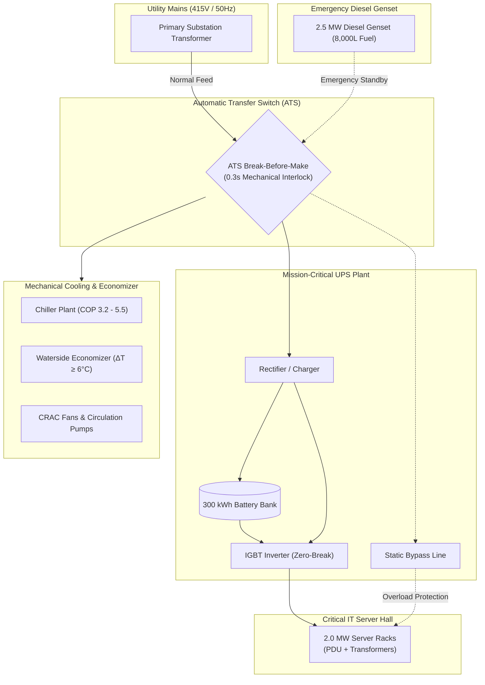

# ⚡ DC Power Chain Simulator (ATS + Online UPS + Genset + PUE)

[](https://github.com/dhruvameena7855/dc-power-chain-simulator/actions/workflows/deploy.yml)
[](https://github.com/dhruvameena7855/dc-power-chain-simulator/actions)
[](https://dhruvameena7855.github.io/dc-power-chain-simulator/)
[](LICENSE)
[-a855f7.svg?style=flat-square)](#tech-stack)

> **Live Interactive Simulator:** [https://dhruvameena7855.github.io/dc-power-chain-simulator/](https://dhruvameena7855.github.io/dc-power-chain-simulator/)

A high-fidelity, real-time browser simulation of a **Tier-IV 2.0 MW Mission-Critical Data Center Electrical Power Chain**. Models utility grid failure, break-before-make ATS transitions, 2.5 MW diesel genset cranking and synchronization, double-conversion online UPS zero-break battery backup, static bypass overload curves, and dynamic PUE thermodynamic optimization with waterside economizer free cooling.

---

## 🌟 Key Features

- **⚡ Zero-Break Online Double-Conversion UPS (2.0 MW, 300 kWh Battery):**
  - Models rectifier-inverter conversion efficiency curves peaking at 96.5%.
  - Zero-break battery discharge ($0\text{ ms}$ transfer gap) during utility outages.
  - Multi-tier inverse-time overload protection ($105\%$ for $60\text{ s}$, $125\%$ for $10\text{ s}$, $150\%$ immediate) transferring to static bypass.
- **🔄 Automatic Transfer Switch (ATS) State Engine:**
  - Break-before-make ($0.3\text{ s}$) mechanical interlock to prevent source paralleling.
  - $0.5\text{ s}$ outage confirmation timer and $20\text{ s}$ grid stability verification timer before retransfer.
- **⚙️ 2.5 MW Diesel Generator Black Start:**
  - Automated crank, warm-up, rated V/Hz synchronization, islanded operation, and turbocharger cooldown cycle.
  - Simulated crank failure mode (3 failed attempts triggering battery depletion).
- **🌱 Real-Time PUE & ESG Telemetry:**
  - Dynamic PUE tracking comparing current cooling set-point against legacy $18\text{ }^\circ\text{C}$ baseline.
  - Waterside economizer free-cooling whenever outdoor ambient is $\ge 6\text{ }^\circ\text{C}$ below supply set-point.
  - Live cost tracking in Indian Rupees (₹), diesel fuel consumption, and carbon emissions avoided ($t\text{ CO}_2/\text{year}$).
- **📡 Dual-Channel Bus Oscilloscope:**
  - Digital phosphor CRT simulation showing 415 V / 50 Hz utility mains phase voltage vs. conditioned IT bus in real-time.
- **🎨 Ultra-Modern Aesthetic Glassmorphism UI:**
  - Theme switcher with Dark, Light, and Cyber Neon color palettes.
  - Responsive single-line electrical mimic panel with animated power flow lines.

---

## 🏗️ Architecture & Single-Line Electrical Topology



---

## 🕹️ Interactive Scenarios to Test

1. **Standard 90s Outage Drill:**
   - Click **`⏱️ 90s Outage Drill`** (or press the preset button).
   - Watch the UPS battery seamlessly take over ($0\text{ ms}$ interruption).
   - Observe the diesel genset crank, synchronize in $9\text{ s}$, and accept facility load through the ATS.
2. **Genset Fail-to-Start (Blackout + Fault):**
   - Click **`⚠️ Genset Fail: ON`** and click **`⚡ Grid Failure`**.
   - Notice the genset fail after 3 crank cycles.
   - Watch the battery SOC deplete until the critical load drops (Sev-1 catastrophic failure).
3. **IT Surge Overload:**
   - Click **`💥 Surge +900 kW`** to exceed UPS 2000 kW capacity.
   - Watch the inverse-time overload timer expire and execute a zero-break transfer to static bypass.
4. **Economizer Free-Cooling:**
   - Click **`Eco Free-Cool`** (sets ambient to $10\text{ }^\circ\text{C}$).
   - Notice chiller power decrease and facility PUE drop toward $\sim 1.15$.

---

## 📐 Mathematical & Engineering Model

### 1. UPS Inverter Efficiency Curve
$$\eta(f) = 0.965 - 0.07 \cdot e^{-10 \cdot f}$$
where $f = \frac{P_{\text{IT}}}{P_{\text{UPS, rated}}}$. Peaks near $96.5\%$ for load factors above $40\%$.

### 2. Chiller Coefficient of Performance (COP)
$$\text{COP} = \left[3.2 + 0.22 \cdot (T_{\text{set}} - 18)\right] \cdot \left[1 - 0.012 \cdot \max(0, T_{\text{amb}} - 25)\right]$$
Elevating chilled water supply set-point by $1\text{ }^\circ\text{C}$ improves chiller efficiency by $\sim 4\text{--}6\%$.

### 3. Waterside Economizer Free Cooling
$$f_{\text{free}} = \text{clamp}\left(\frac{T_{\text{set}} - 6 - T_{\text{amb}}}{6}, 0, 1\right)$$
When outdoor ambient drops $6\text{ }^\circ\text{C}$ below set-point, chillers can be partially or completely unloaded.

### 4. Facility PUE Calculation
$$\text{PUE} = \frac{P_{\text{total}}}{P_{\text{IT}}} = \frac{P_{\text{UPS, in}} + P_{\text{cooling}} + P_{\text{misc}}}{P_{\text{IT}}}$$

---

## 🚀 Deployment & Local Development

### Live Deployment to GitHub Pages
This repository is configured with automated GitHub Actions continuous deployment (`.github/workflows/deploy.yml`).

1. Push your changes to the `main` branch.
2. In your GitHub repository:
   - Navigate to **Settings** &rarr; **Pages**.
   - Under **Build and deployment** &rarr; **Source**, ensure **GitHub Actions** is selected.
3. Your simulator is automatically built, verified, and live at:
   ```
   https://dhruvameena7855.github.io/dc-power-chain-simulator/
   ```

### Run Locally
No build tools or heavy packages required:

```bash
# Clone the repository
git clone https://github.com/dhruvameena7855/dc-power-chain-simulator.git
cd dc-power-chain-simulator

# Open index.html directly in your favorite browser, or start a static server:
npx serve .
# or with Python:
python -m http.server 8080
```

### Run Automated Headless Verification Tests
```bash
node tests/headless.test.js
```

---

## 📁 Repository Structure

```
├── .github/
│   └── workflows/
│       ├── test.yml            # CI test runner
│       └── deploy.yml          # Automated GitHub Pages CD pipeline
├── docs/
│   └── ARCHITECTURE.md         # Detailed state machine & electrical diagrams
├── tests/
│   └── headless.test.js        # Node.js DOM-free unit test suite
├── app.js                      # Simulation physics engine, state machines & canvas renderers
├── index.html                  # HTML5 semantic dashboard markup & SCADA mimic SVG
├── style.css                   # Glassmorphism design system & theme definitions
├── LICENSE                     # MIT License
└── README.md                   # Project documentation
```

---

## 📜 License

Distributed under the [MIT License](LICENSE). Built for electrical engineers, data center facilities managers, and cloud infrastructure architects.
